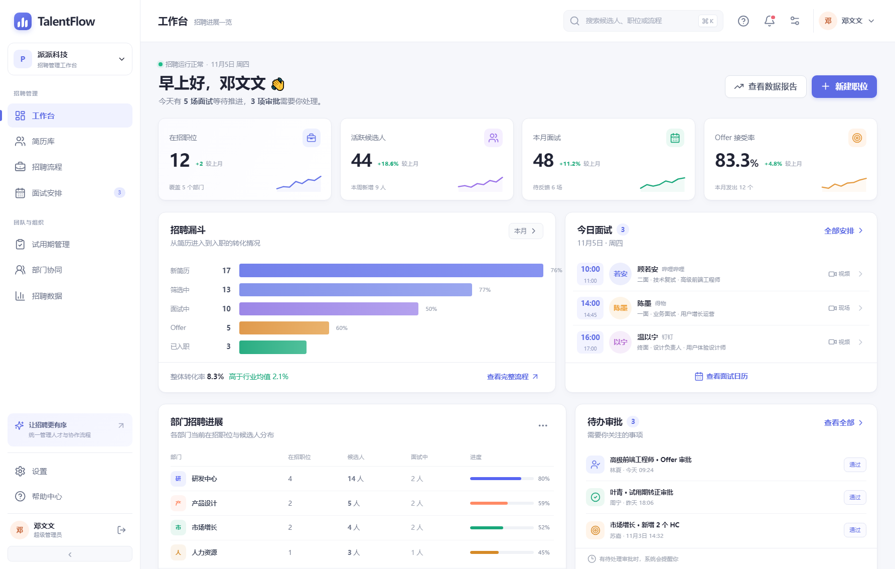
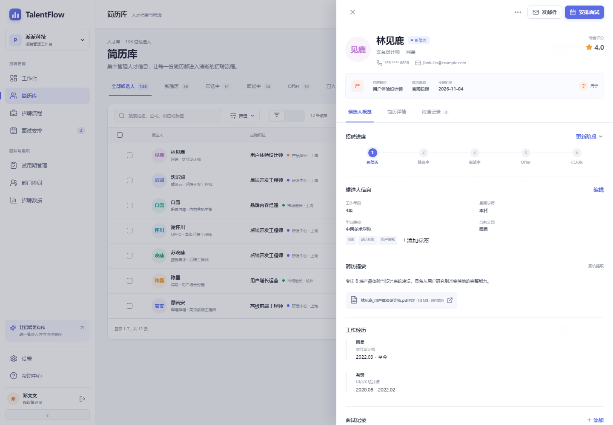

# TalentFlow 招聘管理

一套面向招聘团队的中文工作台，覆盖从候选人入库、招聘流程推进、面试安排到试用期跟踪和招聘数据分析的完整链路。

## 功能

- 招聘工作台：关键指标、待办事项和近期动态
- 简历库：搜索、筛选、候选人详情与新增候选人
- 招聘流程：按阶段管理和推进候选人
- 面试安排：创建面试、协调时间并记录反馈
- 试用期管理：跟进新员工成长状态
- 部门协同：查看业务团队与招聘协作情况
- 招聘数据：用图表呈现渠道、效率和转化数据

## 技术栈

- React 18
- TypeScript
- Vite
- Lucide React

## 本地运行

```bash
npm install
npm run dev
```

开发服务器默认运行在 `http://localhost:4173`。

## 构建

```bash
npm run build
npm run preview
```

## 截图




